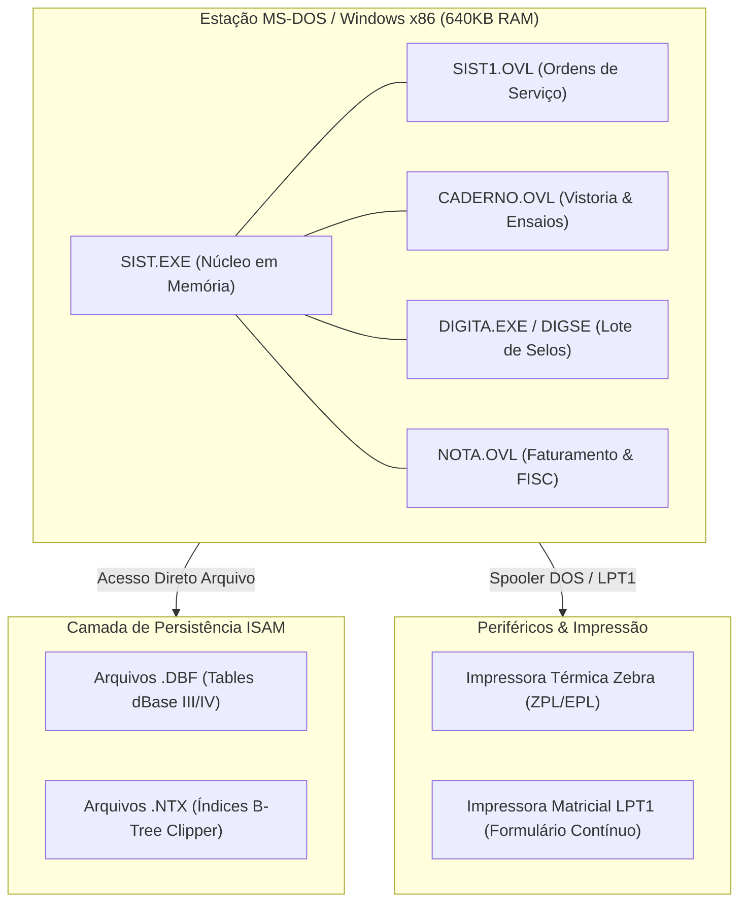
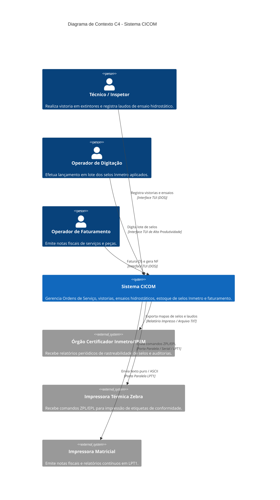
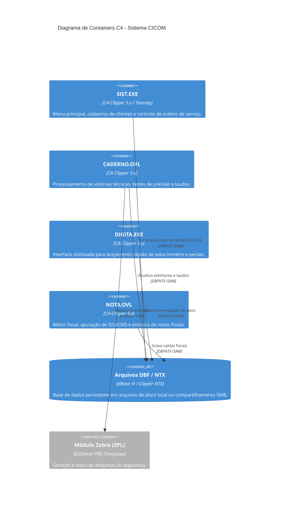

# Arquitetura do Sistema CICOM

> Gerado pelo Arquiteto do Reversa em 2026-09-18  
> Nível de Documentação: **Detalhado**  
> Status: 🟢 **CONFIRMADO** (Baseado em análise completa do código-fonte CA-Clipper e artefatos de extração)

---

## 1. Visão Geral da Arquitetura

O **CICOM** (Sistema de Controle de Manutenção de Extintores e Selos Inmetro) é uma aplicação desktop comercial desenvolvida no final da década de 1980 e expandida na década de 1990 em **CA-Clipper (Summer '87 / Clipper 5.x)** para a plataforma **MS-DOS 16-bit**.

O sistema adota o estilo arquitetural **Monólito Desktop Modularizado**, utilizando **Dynamic Overlays (`.OVL`)** por meio do linker nativo **RTLINK**. Essa escolha permitiu estruturar um sistema corporativo denso operando rigorosamente dentro do limite dos **640 KB de memória RAM convencional** do MS-DOS.



---

## 2. Visão Geral dos Módulos Funcionais

O sistema é dividido em **6 módulos funcionais** independentes e interconectados:

| Módulo | Escopo & Responsabilidade | Entry Points Principais | Nível de Complexidade |
| :--- | :--- | :--- | :---: |
| **`sist_main`** | Menu principal, controle de acesso, navegação global e cabeçalho de Ordens de Serviço (OS). | `SIST.PRG`, `SIST1.PRG` | Alta |
| **`caderno_extintores`** | Vistoria técnica, ensaio hidrostático (Nível 3), inspeção de cilindros e emissão de laudos técnicos. | `CADERNO1.PRG` - `CADERNO5.PRG`, `caderno.prg` | Alta |
| **`digita_selos`** | Módulo de alta produtividade para lançamento em lote, alocação de selos Inmetro e controle de perdas (`FALTASEL`). | `DIGITA.PRG`, `digse.prg`, `acerto.PRG` | Média |
| **`faturamento_notas`** | Emissão de Notas Fiscais de Serviço (ISSQN) e Peças (ICMS), cálculo de impostos e apuração diária. | `nota.prg`, `lancar.prg`, `SAIDA.DBF` | Alta |
| **`etiquetas_zebra`** | Templates e utilitários de geração de código ZPL/EPL para impressão de etiquetas adesivas de conformidade. | `EtiZebra/` (`ETIQUETA.PRG`, `EtiNR23/`) | Baixa |
| **`cadastros_base`** | Cadastros mestres (Clientes, Vendedores, Tabelas) e biblioteca de funções utilitárias (CNPJ, reindexação). | `PEQLIB.PRG`, `FUNCAO.PRG`, `TBR12.PRG` | Média |

---

## 3. Decisões Arquiteturais Fundamentais (ADRs)

| ADR ID | Título | Decisão Sumária | Impacto / Consequência |
| :--- | :--- | :--- | :--- |
| **[ADR 0001](file:///c:/Inmetro/_reversa_sdd/adrs/0001-arquitetura-monolitica-clipper-overlays.md)** | Arquitetura Monolítica com Dynamic Overlays | Uso de RTLINK e estruturas `.OVL` para alternar telas no limite de 640 KB RAM. | Alta dependência de memória convencional; exige emulador (vDOS/DOSBox) em x64. |
| **[ADR 0002](file:///c:/Inmetro/_reversa_sdd/adrs/0002-banco-de-dados-isam-dbf-ntx.md)** | Persistência ISAM em DBF / NTX | Acesso direto a tabelas dBase III e índices B-Tree Clipper sem servidor SQL. | Busca por `SEEK` ultrarrápida, porém sem transações ACID e risco de corrupção dos NTX. |
| **[ADR 0003](file:///c:/Inmetro/_reversa_sdd/adrs/0003-modulo-independente-alta-produtividade-digita.md)** | Módulo Separado de Digitação de Selos (`DIGITA.PRG`) | Separação da rotina de lançamento de selos em um executável/menu dedicado sem carga completa da TUI. | Produtividade máxima em digitação contínua; exige sincronização estrita de travamento DBF. |
| **[ADR 0004](file:///c:/Inmetro/_reversa_sdd/adrs/0004-impressao-direta-zpl-spooler-matricial.md)** | Emissão Direta ZPL/EPL & Spooler Matricial | Gravação direta de streams ASCII/ZPL para as portas `LPT1`/`COM1`. | Impressão instantânea sem spooler gráfico; acoplamento severo com modelos de impressora física. |

---

## 4. Diagramas C4 Sintéticos

### 4.1 Nível 1: C4 Contexto (Resumido)


### 4.2 Nível 2: C4 Containers (Resumido)


---

## 5. Atributos de Qualidade e Restrições Técnicas

### 5.1 Restrições de Hardware & Execução 🔴
- **Memória RAM Limite:** 640 KB (Memória convencional MS-DOS). Não utiliza extensores DPMI de 32 bits.
- **Sistema Operacional Nativo:** MS-DOS 3.3 a 6.22 / Windows 95/98 (NTVDM).
- **Execução em OS Modernos (Windows 10/11 x64):** Exige obrigatoriamente ambiente de emulação 16-bit (**vDOS**, **DOSBox-Staging** ou **NTVDMx64**).

### 5.2 Mecanismo de Concorrência & Travamento de Dados 🟡
- **Lock por Registro (`RLOCK()`):** Utilizado em atualizações pontuais (ex: atribuir selo a um item em `MOV_ITEM.DBF`).
- **Lock por Arquivo (`FLOCK()`):** Utilizado na abertura de OS, reindexação (`findex.prg`) e fechamento mensal.
- **Risco de Deadlock:** Trancamento manual por laço `WHILE !RLOCK()` pode congelar a sessão caso um operador abandone o sistema com a tela aberta.

### 5.3 Integridade de Dados & Resiliência 🔴
- **Falta de Transações ACID:** Falha de energia durante gravação de OS pode deixar `MOVTO.DBF` atualizado enquanto `MOV_ITEM.DBF` fica incompleto.
- **Índices NTX Instáveis:** Quedas de energia frequentemente corrompem os ponteiros dos arquivos `.NTX`, exigindo execução manual da rotina de reindexação (`PEQLIB.PRG` / `findex`).

---

## 6. Mapeamento de Dívidas Técnicas & Oportunidades de Modernização

```mermaid
quadrantChart
    title Matriz de Débito Técnico x Impacto na Modernização
    x-axis Baixa Urgência --> Alta Urgência
    y-axis Baixo Impacto Arquitetural --> Alto Impacto Arquitetural
    quadrant-1 Prioridade Máxima (Refatorar Imediatamente)
    quadrant-2 Arquitetural Crítico (Planejar Redesenho)
    quadrant-3 Baixo Risco (Manter ou Migrar no Fim)
    quadrant-4 Ajustes Operacionais (Ganhos Rápidos)
    
    "Arquivos ISAM DBF sem ACID": [0.85, 0.90]
    "Dependência 16-bit DOS / 640KB": [0.90, 0.85]
    "Variáveis Globais PUBLIC/PRIVATE": [0.70, 0.75]
    "Impressão Direta ZPL em LPT1": [0.75, 0.60]
    "Ausência de Validadores de Schemas": [0.40, 0.50]
    "Interface TUI com Gravação Direta Tela": [0.30, 0.40]
```

---

## 7. Caminho Recomendado para Arquitetura Alvo (Greenfield / Migração)

1. **Camada de Dados:** Migrar de DBF/NTX para **PostgreSQL 15+** com suporte nativo a transações ACID e constraints de `FOREIGN KEY` (garantindo rastreabilidade estrita de selos Inmetro).
2. **Backend API:** Desenvolver uma API RESTful em **Node.js (TypeScript)** ou **Go / C# .NET**, isolando as regras de negócio de manutenção, vistorias e faturamento.
3. **Frontend:** Criar aplicação Web Responsiva em **React / Next.js / TailwindCSS** com suporte a digitação ultra-rápida via atalhos de teclado (preservando a ergonomia do módulo `DIGITA`).
4. **Módulo de Impressão:** Implementar serviço micro-spooler em rede (WebZebra / RawPrint) para disparo de relatórios e etiquetas ZPL diretamente para impressoras térmicas via IP/Ethernet.
