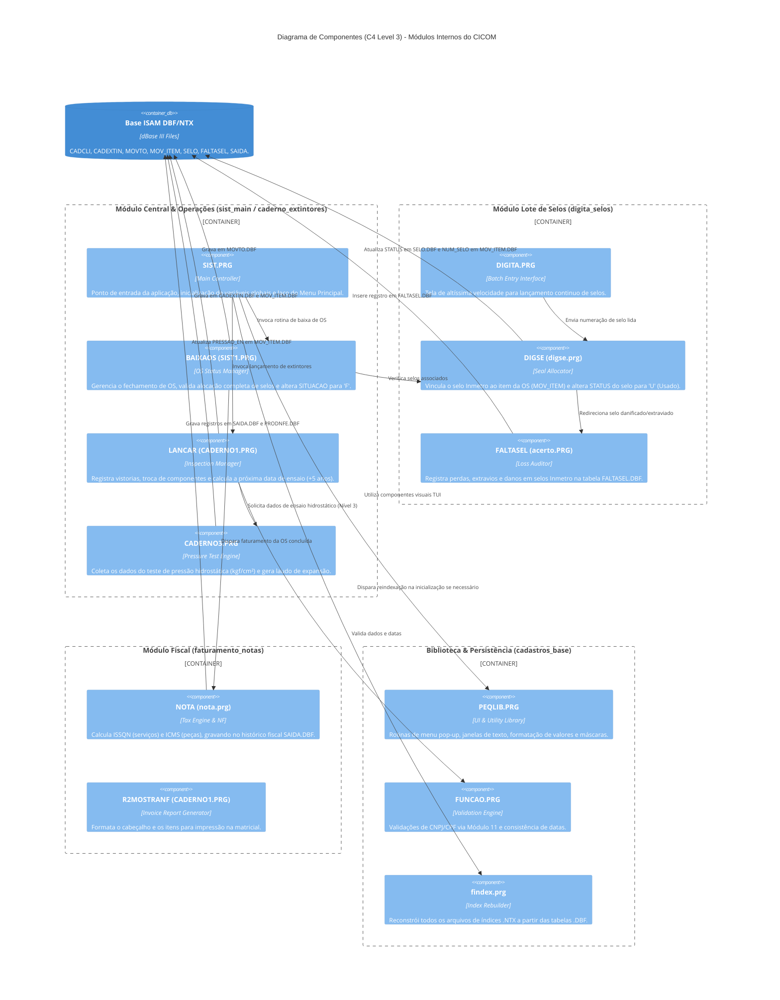
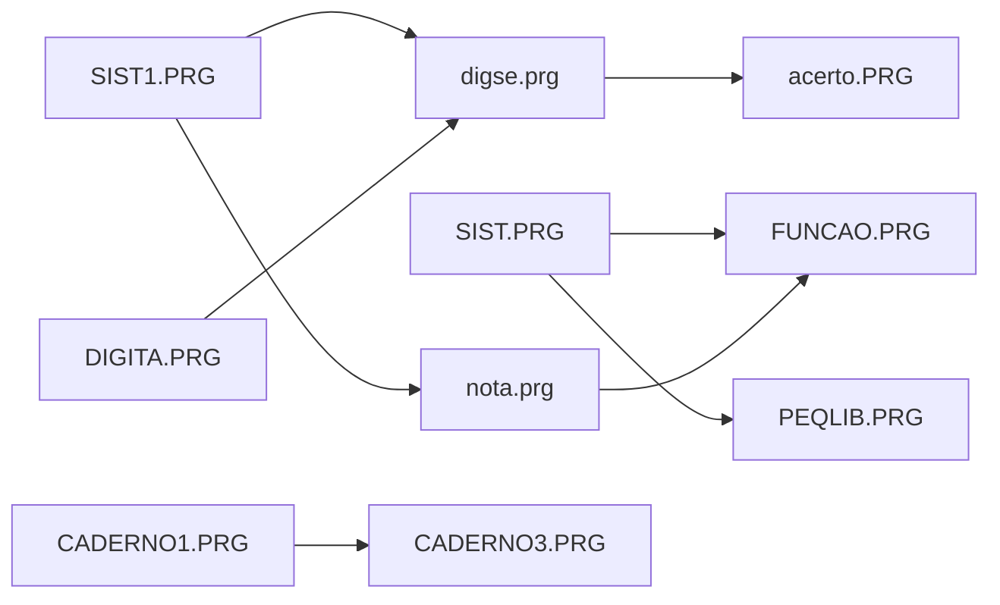

# Diagrama C4 — Componentes (Nível 3) — CICOM

> Gerado pelo Arquiteto do Reversa em 2026-09-18  
> Nível de Documentação: **Detalhado**  
> Status: 🟢 **CONFIRMADO**

---

## 1. Diagrama de Componentes C4 (Mermaid)

---

## 2. Descrição Detalhada dos Componentes

### 2.1 Componentes do Núcleo e Vistorias (`sist_main` / `caderno_extintores`)

| Componente | Arquivo Fonte | Responsabilidade Principal | Invocado por |
| :--- | :--- | :--- | :--- |
| **`SIST`** | `prg/SIST.PRG` | Ponto de entrada, inicialização das variáveis públicas (`cEmpresa`, `dDataSis`), tratamento da tela principal e roteamento do menu principal. | MS-DOS / `Cicom.bat` |
| **`BAIXAOS`** | `prg/SIST1.PRG` | Validação e fechamento da Ordem de Serviço. Verifica se todos os itens possuem selo Inmetro e calcula o valor total. | `SIST.PRG` |
| **`LANCAR`** | `prg/CADERNO1.PRG` | Interface de entrada de extintores na OS. Atualiza a tabela `CADEXTIN.DBF` e define a periodicidade dos ensaios. | `SIST.PRG` / Menu Caderno |
| **`PRESSAO`** | `prg/CADERNO3.PRG` | Registra a pressão de teste aplicada (kgf/cm²) e a expansão volumétrica em cilindros de alta pressão (CO2/PQS). | `CADERNO1.PRG` |

---

### 2.2 Componentes de Controle de Selos Inmetro (`digita_selos`)

| Componente | Arquivo Fonte | Responsabilidade Principal | Invocado por |
| :--- | :--- | :--- | :--- |
| **`DIGITA`** | `prg/DIGITA.PRG` | Interface em lote otimizada para alta produtividade de digitação (sem delays ou menus intermediários). | Executável autônomo / Menu |
| **`DIGSE`** | `prg/digse.prg` | Valida se a numeração do selo digitado está cadastrada em `SELO.DBF` no status Estoque (`E`) e realiza o vínculo com a OS. | `DIGITA.PRG` / `SIST1.PRG` |
| **`FALTASEL`**| `prg/acerto.PRG` | Registra e justifica a perda, destruição física ou erro de gravação de selos em `FALTASEL.DBF` para auditoria do Inmetro/IPEM. | `DIGSE()` / Menu Digitação |

---

### 2.3 Componentes Fiscais e de Faturamento (`faturamento_notas`)

| Componente | Arquivo Fonte | Responsabilidade Principal | Invocado por |
| :--- | :--- | :--- | :--- |
| **`NOTA`** | `prg/nota.prg` | Efetua a apuração fiscal desmembrando impostos municipais (ISSQN) de estaduais (ICMS sobre peças), gravando a Nota Fiscal em `SAIDA.DBF`. | `BAIXAOS()` / Menu Fiscal |
| **`R2MOSTRANF`**| `prg/CADERNO1.PRG` | Formata o espelho da nota fiscal e direciona o fluxo de dados ASCII diretamente para a impressora matricial em `LPT1`. | `NOTA()` |

---

### 2.4 Componentes Utilitários e Infraestrutura (`cadastros_base`)

| Componente | Arquivo Fonte | Responsabilidade Principal | Invocado por |
| :--- | :--- | :--- | :--- |
| **`PEQLIB`** | `prg/PEQLIB.PRG` | Biblioteca central contendo funções de interface gráfica TUI (janelas `BOX`, mensagens de alerta, seletores de cor). | Todos os módulos |
| **`FUNCAO`** | `prg/FUNCAO.PRG` | Biblioteca de rotinas de validação de CNPJ/CPF (Módulo 11), máscaras de formatação e cálculos de datas. | Todos os módulos |
| **`findex`** | `prg/Busca.prg` / `PEQLIB.PRG` | Utilitário de emergência que lê as tabelas `.DBF` e re-cria todos os índices `.NTX` corrompidos por travamento ou queda de luz. | `SIST.PRG` (no boot do sistema) |

---

## 3. Matriz de Dependência entre Componentes Internos

