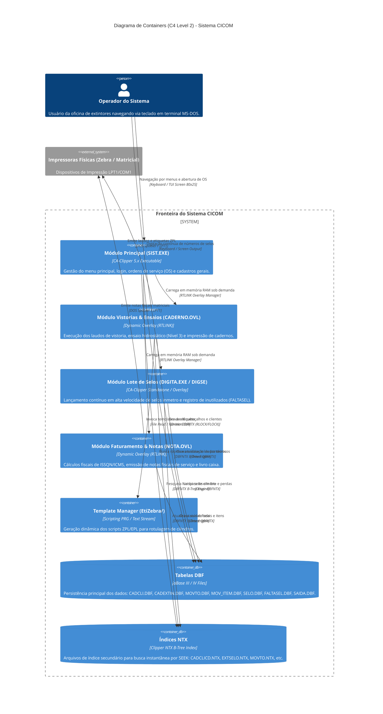

# Diagrama C4 — Containers (Nível 2) — CICOM

> Gerado pelo Arquiteto do Reversa em 2026-09-18  
> Nível de Documentação: **Detalhado**  
> Status: 🟢 **CONFIRMADO**

---

## 1. Diagrama de Containers C4 (Mermaid)

---

## 2. Detalhamento dos Containers

### 2.1 Módulo Principal (`SIST.EXE`)
- **Tecnologia:** CA-Clipper 5.x / RTLINK.
- **Função:** Controlar o ciclo de vida da aplicação, validar credenciais do operador, gerenciar a abertura e fechamento de Ordens de Serviço (`MOVTO.DBF`), e carregar os overlays de negócio (`.OVL`).
- **Comunicação:** Interface direta TUI (Text User Interface) com tela de 80 colunas e 25 linhas (`@ SAY ... GET`).

### 2.2 Módulo de Vistorias e Ensaios (`CADERNO.OVL`)
- **Tecnologia:** CA-Clipper Dynamic Overlay.
- **Função:** Gerenciar os dados técnicos de manutenção dos extintores. Controlar vistorias (Nível 1), recargas (Nível 2) e testes de pressão hidrostática a 250 kgf/cm² (Nível 3).
- **Comunicação:** Manipulação direta das tabelas `CADEXTIN.DBF` e `MOV_ITEM.DBF`.

### 2.3 Módulo de Lançamento em Lote de Selos (`DIGITA.EXE` / `DIGSE`)
- **Tecnologia:** Executável Autônomo em CA-Clipper / Sub-rotina dedicada.
- **Função:** Prover uma tela simplificada e ultrarrápida para que o operador digite em sequência os selos Inmetro aplicados em cada cilindro, registrando divergências e selos danificados em `FALTASEL.DBF`.
- **Comunicação:** Leitura e atualização rápida em laço da tabela `SELO.DBF`.

### 2.4 Módulo de Faturamento e Notas (`NOTA.OVL`)
- **Tecnologia:** CA-Clipper Dynamic Overlay.
- **Função:** Apurar os valores dos serviços executados e das peças trocadas na OS, desmembrando as alíquotas de ISSQN (serviço municipal) e ICMS (peças estaduais), registrando em `SAIDA.DBF` e emitindo formulário fiscal.
- **Comunicação:** Emissão de texto ASCII formatado direto para a porta paralela `LPT1`.

### 2.5 Gerenciador de Templates Zebra (`EtiZebra/`)
- **Tecnologia:** Coleção de sub-rotinas Clipper (`ETIQUETA.PRG`, `EtiNR23/`).
- **Função:** Montar as strings de comandos na linguagem **ZPL II (Zebra Programming Language)** ou **EPL2**, injetando variáveis de sistema (Número de Série, Selo Inmetro, Data de Validade) e enviando a stream para a impressora.

### 2.6 Motor de Persistência ISAM (`DBF` / `NTX`)
- **Tecnologia:** dBase III Standard / Clipper DBFNTX RDD.
- **Função:** Armazenar dados em arquivos binários em disco. A busca é acelerada via comandos `SEEK` sobre arquivos de índices B-Tree (`.NTX`).

---

## 3. Protocolos e Mecanismos de Integração Interna

| Origem | Destino | Mecanismo | Protocolo / Formato |
| :--- | :--- | :--- | :--- |
| `SIST.EXE` | Overlays (`.OVL`) | Carga de Memória por Demanda | RTLINK Dynamic Overlay Exec |
| Modulos Clipper | `DBFNTX Engine` | Chamadas RDD de Baixo Nível | File Locks (`FLOCK`/`RLOCK`) em disco local/SMB |
| Módulo Caderno | Impressora Zebra | Output Stream em Porta DOS | Text Streams ZPL II (`^XA ... ^XZ`) via LPT1 |
| Módulo Faturamento | Impressora Matricial | Output Stream em Porta DOS | ASCII Plain Text + Esc/P com `SET PRINTER TO LPT1` |
