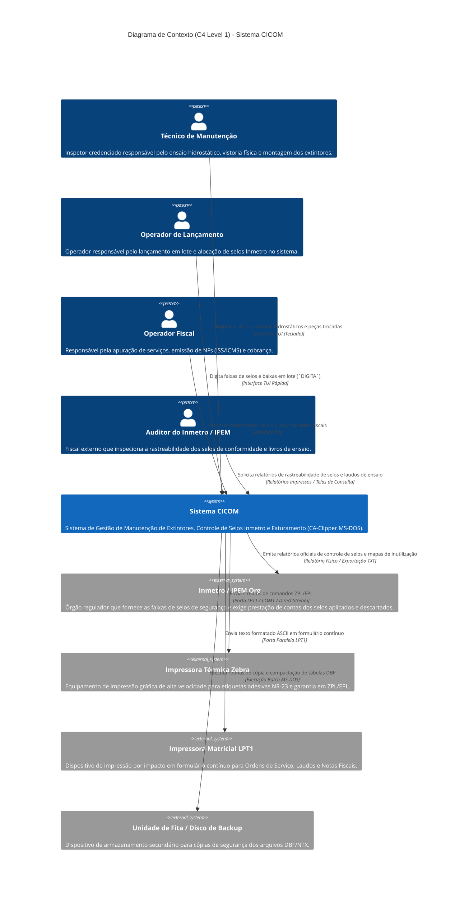

# Diagrama C4 — Contexto (Nível 1) — CICOM

> Gerado pelo Arquiteto do Reversa em 2026-09-18  
> Nível de Documentação: **Detalhado**  
> Status: 🟢 **CONFIRMADO**

---

## 1. Diagrama de Contexto C4 (Mermaid)

---

## 2. Descrição das Entidades de Contexto

### 2.1 Personas & Usuários Internos

| Persona | Papel & Objetivo no Sistema | Principais Telas / Módulos Utilizados |
| :--- | :--- | :--- |
| **Técnico de Manutenção** | Inserir os dados das inspeções técnicas (Nível 1, 2 e 3), medir pressão de teste hidrostático e indicar peças substituídas. | `CADERNO1.PRG`, `CADERNO2.PRG`, `caderno.prg` |
| **Operador de Lançamento** | Registrar os lotes de selos recebidos do IPEM e vincular cada selo a um extintor na OS com extrema rapidez. | `DIGITA.PRG`, `digse.prg`, `acerto.PRG` |
| **Operador Fiscal** | Concluir ordens de serviço, desmembrar impostos (ISSQN vs ICMS) e emitir as notas fiscais correspondentes. | `nota.prg`, `lancar.prg`, `SIST1.PRG` (`BAIXAOS`) |
| **Auditor / Responsável Técnico** | Garantir a conformidade legal perante as portarias do Inmetro e assinar os laudos de ensaio hidrostático. | `CADERNO3.PRG`, `R2EXTINTOR()` |

---

### 2.2 Sistemas Externos & Periféricos

| Sistema Externo / Ator | Tipo de Integração | Protocolo / Formato | Descrição da Interação |
| :--- | :--- | :--- | :--- |
| **Inmetro / IPEM** | Auditoria Externa | Relatórios em Papel / TXT | Recebe a prestação de contas mensal contendo os selos utilizados, extintores atendidos e selos inutilizados (`FALTASEL`). |
| **Impressora Zebra** | Periférico de Impressão | Comandos ZPL / EPL (ASCII) | Impressão de etiquetas de conformidade coladas diretamente no casco do extintor. |
| **Impressora Matricial** | Periférico de Impressão | Texto Puro via `SET PRINTER TO LPT1` | Impressão de vias de Ordens de Serviço, laudos de ensaio hidrostático e formulários fiscais. |
| **Gerenciador de Backup** | Utilitário de Sistema | Scripts Batch DOS (`.BAT`) | Copia os arquivos `.DBF` e `.NTX` para mídias externas de segurança. |

---

## 3. Limites do Sistema Legado

1. **Escopo Interno:** O CICOM engloba desde a entrada do extintor na oficina (OS) até o laudo técnico, alocação de selo Inmetro e faturamento.
2. **Escopo Fora do Sistema:** O sistema não possui integração bancária online (bloquetos emissores via API/CNAB nativo), não possui comunicação HTTP/WebServices com secretarias de fazenda (NFe SEFAZ moderna) e não possui portal de clientes na web.
