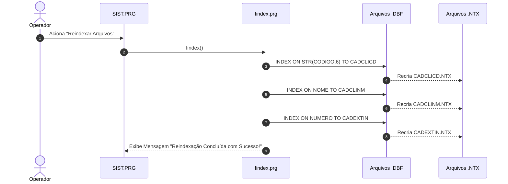

# Módulo Cadastros Base e Bibliotecas Reutilizáveis (`cadastros_base`), Design Técnico

> Gerado pelo Redator do Reversa em 2026-09-18  
> Nível de Documentação: **Detalhado**  
> Status: 🟢 **CONFIRMADO** (Baseado nos fontes `prg/PEQLIB.PRG`, `prg/FUNCAO.PRG`)

---

## 1. Interface e Assinatura das Funções

| Símbolo | Assinatura / Parâmetros | Retorno | Descrição & Localização |
| :--- | :--- | :--- | :--- |
| `ValidaCNPJ()` | `(cCNPJ: Character)` | `Logical` | Algoritmo Módulo 11 para CNPJ. (`FUNCAO.PRG:150`) |
| `ValidaCPF()` | `(cCPF: Character)` | `Logical` | Algoritmo Módulo 11 para CPF. (`FUNCAO.PRG:210`) |
| `findex()` | `()` | `NIL` | Reconstrói todos os arquivos `.NTX`. (`Busca.prg:45`) |
| `Box()` | `(nT, nL, nB, nR, cTitulo)` | `NIL` | Desenha moldura na tela TUI. (`PEQLIB.PRG:80`) |

---

## 2. Fluxo Principal da Reindexação (`findex`)

---

## 3. Decisões de Design Identificadas

| Decisão | Evidência no Código Legado | Confiança |
| :--- | :--- | :---: |
| **Algoritmo Nativo Módulo 11 Sem Dependências de Terceiros** | Função pura em `FUNCAO.PRG:150` | 🟢 |
| **Reconstrução Total de Índices em Loop Único** | Rotina batch `findex.prg` | 🟢 |
