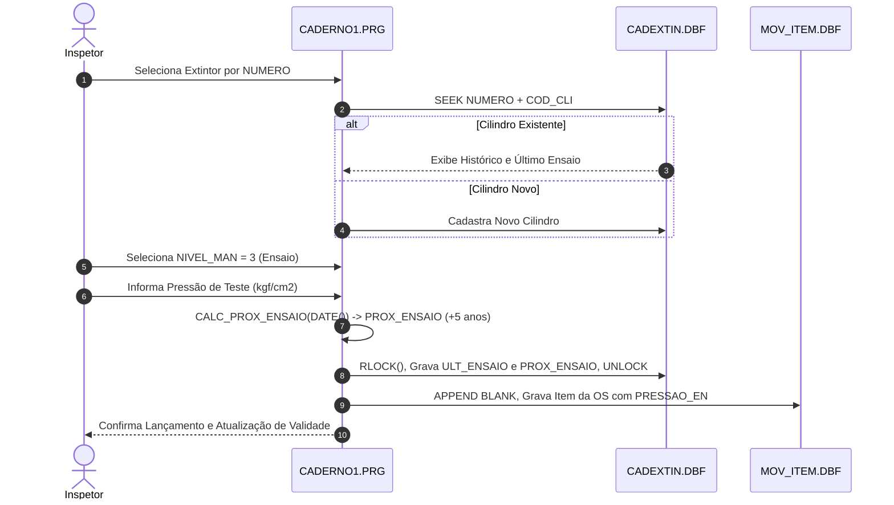

# Módulo Caderno de Vistorias e Ensaios Hidrostáticos (`caderno_extintores`), Design Técnico

> Gerado pelo Redator do Reversa em 2026-09-18  
> Nível de Documentação: **Detalhado**  
> Status: 🟢 **CONFIRMADO** (Baseado nos fontes `prg/CADERNO1.PRG` a `prg/CADERNO5.PRG` e `prg/caderno.prg`)

---

## 1. Interface e Assinatura das Funções

| Símbolo | Assinatura / Parâmetros | Retorno | Descrição & Localização |
| :--- | :--- | :--- | :--- |
| `LANCAR()` | `()` | `NIL` | Interface de digitação e inclusão de extintores na OS. (`CADERNO1.PRG:40`) |
| `R2EXTINTOR()` | `(pArquivo: Character, pColunas: Numeric, pDireciona: Character)` | `NIL` | Geração do relatório e laudo técnico de ensaios hidrostáticos. (`CADERNO1.PRG:280`) |
| `CALC_PROX_ENSAIO()`| `(dUltEnsaio: Date)` | `Date` | Adiciona 5 anos à data informada (`dUltEnsaio + (365 * 5)`). (`CADERNO1.PRG:238`) |
| `VALIDA_PRESSAO()` | `(nPressao: Numeric, cAgente: Character)` | `Logical` | Valida se a pressão em kgf/cm² atende ao especificado. (`CADERNO3.PRG:95`) |

---

## 2. Fluxo Principal de Processamento de Ensaio

---

## 3. Decisões de Design Identificadas

| Decisão | Evidência no Código Legado | Confiança |
| :--- | :--- | :---: |
| **Cálculo Fixo de 5 Anos de Validade** | `dProxEnsaio := dUltEnsaio + (365*5)` em `CADERNO1.PRG:238` | 🟢 |
| **Chave Composta Lógica de Busca** | Chave `STR(COD_CLI,6)+NUMERO` no índice `CADEXTI1.NTX` | 🟢 |
| **Direct Stream Print para Laudos** | Comandos `SET PRINTER TO LPT1` e `SET MARGIN TO 0` em `R2EXTINTOR` | 🟢 |

---

## 4. Riscos e Lacunas

- 🔴 **Diferença de Anos Bissextos no Cálculo de Data:** O uso da fórmula simples `+ (365 * 5)` pode gerar desvio de 1 ou 2 dias na data do próximo ensaio em períodos com anos bissextos. Recomenda-se usar adição exata de 5 anos no calendário (`AddYears(5)`).
- 🟡 **Ausência de Assinatura Digital no Laudo:** O laudo é emitido em formulário impresso e assinado manualmente pelo responsável técnico.
