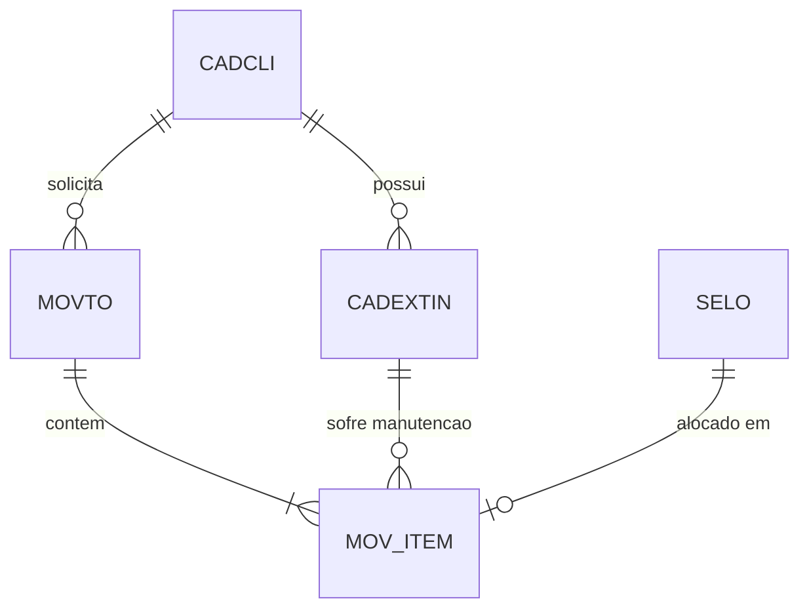

# Dicionário de Dados do Sistema Legado — CICOM

> Gerado pelo Arqueólogo do Reversa em 2026-09-18
> Nível de Documentação: **Detalhado**

---

## 1. Mapeamento Geral do Modelo xBase DBF

O banco de dados do **CICOM** é composto por tabelas dBase III/IV (`.DBF`) e arquivos de índices nativos do Clipper (`.NTX`).

---

## 2. Estrutura das Tabelas Principais

### 2.1 `CADCLI.DBF` (Cadastro de Clientes) 🟢 CONFIRMADO
- **Descrição:** Armazena os dados cadastrais dos clientes contratantes dos serviços de manutenção.
- **Índices NTX:** `CADCLICD.NTX` (Chave: `STR(CODIGO,6)`), `CADCLINM.NTX` (Chave: `NOME`)

| Campo | Tipo | Tamanho | Decimal | Descrição / Regra | Confiança |
| :--- | :---: | :---: | :---: | :--- | :---: |
| `CODIGO` | Numeric | 6 | 0 | Código identificador único do cliente | 🟢 |
| `NOME` | Character | 45 | - | Razão Social ou Nome do Cliente | 🟢 |
| `FANTASIA` | Character | 20 | - | Nome Fantasia | 🟢 |
| `ENDERECO` | Character | 40 | - | Logradouro e Número | 🟢 |
| `BAIRRO` | Character | 25 | - | Bairro | 🟢 |
| `CIDADE` | Character | 25 | - | Cidade | 🟢 |
| `ESTADO` | Character | 2 | - | Sigla da UF | 🟢 |
| `CEP` | Character | 9 | - | Código de Endereçamento Postal | 🟢 |
| `CNPJ` | Character | 18 | - | CNPJ ou CPF formatado | 🟢 |
| `INSC` | Character | 15 | - | Inscrição Estadual | 🟢 |
| `FONE` | Character | 15 | - | Telefone principal | 🟢 |
| `CONTATO` | Character | 25 | - | Pessoa de contato | 🟢 |

---

### 2.2 `CADEXTIN.DBF` (Cadastro de Cilindros / Extintores) 🟢 CONFIRMADO
- **Descrição:** Registo individualizado de cada cilindro de extintor de incêndio atendido.
- **Índices NTX:** `CADEXTIN.NTX` (Chave: `NUMERO`), `CADSEQUE.NTX` (Chave: `SEQUENCIA`), `CADEXTI1.NTX` (Chave: `STR(COD_CLI,6)`), `EXTSELO.NTX` (Chave: `NUM_SELO1`), `Ordem.NTX` (Chave: `NUM_OS`)

| Campo | Tipo | Tamanho | Decimal | Descrição / Regra | Confiança |
| :--- | :---: | :---: | :---: | :--- | :---: |
| `NUMERO` | Character | 12 | - | Número de Série gravado no cilindro | 🟢 |
| `SEQUENCIA` | Numeric | 8 | 0 | Número sequencial interno do cilindro | 🟢 |
| `COD_CLI` | Numeric | 6 | 0 | Código do cliente proprietário (`CADCLI.CODIGO`) | 🟢 |
| `CAPACIDADE`| Character | 10 | - | Capacidade da carga (ex: 4kg, 6kg, 10L, 50kg) | 🟢 |
| `AGENTE` | Character | 10 | - | Agente extintor (PQS, CO2, Água, Espuma, Halon) | 🟢 |
| `FABRICANTE`| Character | 15 | - | Marca/Fabricante do vaso de pressão | 🟢 |
| `ANO_FABR` | Numeric | 4 | 0 | Ano de fabricação do cilindro | 🟢 |
| `ULT_ENSAIO`| Date | 8 | - | Data do último ensaio hidrostático (Nível 3) | 🟢 |
| `PROX_ENSAIO`| Date | 8 | - | Data limite para próximo ensaio hidrostático | 🟢 |
| `NUM_SELO1` | Character | 12 | - | Número do Selo de Conformidade Inmetro afixado | 🟢 |
| `NUM_OS` | Numeric | 6 | 0 | Número da última Ordem de Serviço | 🟢 |

---

### 2.3 `MOVTO.DBF` (Ordens de Serviço / Cabeçalho) 🟢 CONFIRMADO
- **Descrição:** Cabeçalho das Ordens de Serviço (OS) de manutenção e vistoria.
- **Índices NTX:** `MOVTO.NTX` (Chave: `STR(NUM_OS,6)`), `MOVTO1.NTX` (Chave: `STR(COD_CLI,6)+STR(NUM_OS,6)`)

| Campo | Tipo | Tamanho | Decimal | Descrição / Regra | Confiança |
| :--- | :---: | :---: | :---: | :--- | :---: |
| `NUM_OS` | Numeric | 6 | 0 | Número identificador único da Ordem de Serviço | 🟢 |
| `COD_CLI` | Numeric | 6 | 0 | Código do Cliente | 🟢 |
| `DATA_ENT` | Date | 8 | - | Data de entrada do lote de extintores | 🟢 |
| `DATA_SAI` | Date | 8 | - | Data de saída / devolução prevista ou realizada | 🟢 |
| `VALOR_TOT` | Numeric | 12 | 2 | Valor total da Ordem de Serviço | 🟢 |
| `SITUACAO` | Character | 1 | - | Status da OS (A=Aberta, F=Fechada, C=Cancelada) | 🟢 |
| `TECNICO` | Character | 20 | - | Nome do inspetor técnico responsável | 🟢 |

---

### 2.4 `MOV_ITEM.DBF` (Itens da Ordem de Serviço / Selos) 🟢 CONFIRMADO
- **Descrição:** Detalhamento individual dos serviços executados em cada extintor da OS.
- **Índices NTX:** `MOV_ITEM.NTX` (Chave: `STR(NUM_OS,6)+NUM_EXTIN`), `MOVITEM1.NTX` (Chave: `STR(NUM_SELO,12)`)

| Campo | Tipo | Tamanho | Decimal | Descrição / Regra | Confiança |
| :--- | :---: | :---: | :---: | :--- | :---: |
| `NUM_OS` | Numeric | 6 | 0 | Número da Ordem de Serviço vinculada | 🟢 |
| `NUM_EXTIN` | Character | 12 | - | Número de Série do extintor (`CADEXTIN.NUMERO`) | 🟢 |
| `NIVEL_MAN` | Numeric | 1 | 0 | Nível de manutenção (1=Vistoria, 2=Recarga, 3=Ensaio) | 🟢 |
| `NUM_SELO` | Numeric | 12 | 0 | Número do Selo Inmetro atribuído ao extintor | 🟢 |
| `VALOR_SERV`| Numeric | 10 | 2 | Valor cobrado pelo serviço no extintor | 🟢 |
| `PECAS_TROC`| Character | 40 | - | Descrição sintética das peças e componentes substituídos | 🟢 |
| `PRESSAO_EN`| Numeric | 5 | 2 | Pressão de ensaio aplicada no teste (kgf/cm²) | 🟢 |

---

### 2.5 `SELO.DBF` (Estoque e Controle de Selos Inmetro) 🟢 CONFIRMADO
- **Descrição:** Cadastro e controle de rastreabilidade do lote de selos Inmetro recebidos da gráfica/órgão certificador.
- **Índices NTX:** `NUMSELO.NTX` (Chave: `NUM_SELO`)

| Campo | Tipo | Tamanho | Decimal | Descrição / Regra | Confiança |
| :--- | :---: | :---: | :---: | :--- | :---: |
| `NUM_SELO` | Numeric | 12 | 0 | Número sequencial do Selo Inmetro | 🟢 |
| `SERIE` | Character | 3 | - | Série alfabética do selo | 🟢 |
| `DATA_REC` | Date | 8 | - | Data de recebimento do lote de selos | 🟢 |
| `STATUS` | Character | 1 | - | Status (E=Estoque, U=Usado, D=Danificado/Falta, C=Cancelado) | 🟢 |
| `NUM_OS` | Numeric | 6 | 0 | OS onde o selo foi utilizado | 🟢 |

---

## 3. Diagrama de Relacionamentos (ERD Sintético)

