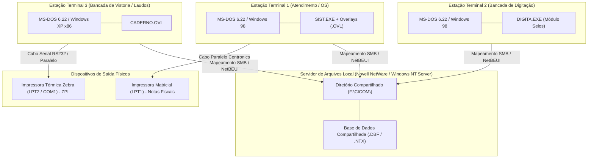
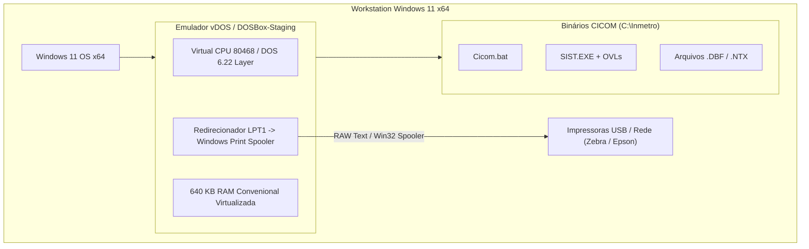
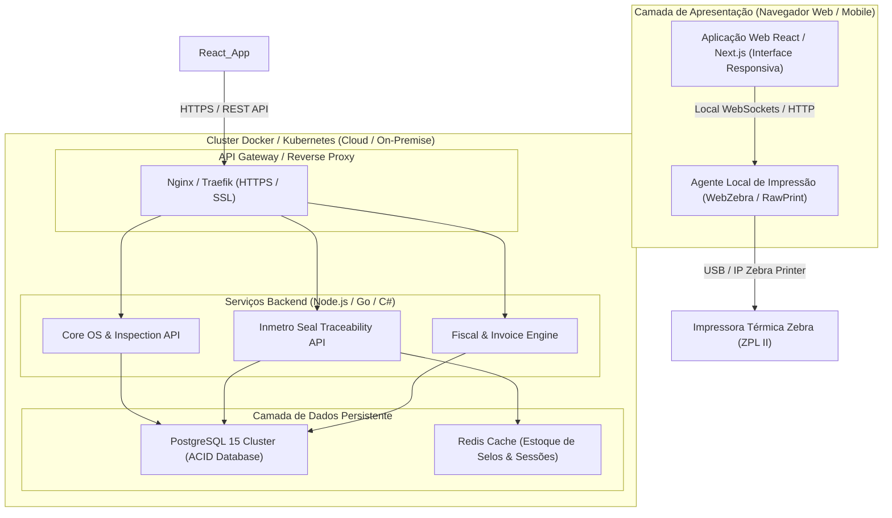

# Diagrama de Infraestrutura e Implantação (Deployment) — CICOM

> Gerado pelo Arquiteto do Reversa em 2026-09-18  
> Nível de Documentação: **Detalhado**  
> Status: 🟢 **CONFIRMADO** (Baseado em arquivos de configuração Batch, Linker e scripts de sistema)

---

## 1. Topologia de Implantação Legada (Ambiente MS-DOS / Redes dos Anos 90/2000)

Historicamente, o **CICOM** era implantado em infraestrutura física local nas oficinas de manutenção de extintores, operando em rede local (LAN) peer-to-peer ou cliente-servidor leve via protocolo **NetBEUI** ou **IPX/SPX (Novell NetWare)**.

---

## 2. Topologia de Execução Atual em Windows 10/11 x64

Sistemas operacionais Windows de 64 bits modernos (Windows 10/11 x64) não possuem suporte nativo a executáveis MS-DOS de 16 bits (ausência da camada NTVDM). Para manter o sistema legado em funcionamento, utiliza-se a seguinte arquitetura de emulação:

### 2.1 Configurações Críticas do DOS Legado

- **`CONFIG.SYS` / `AUTOEXEC.BAT`:**
  - `FILES=120` (Essencial para permitir múltiplos arquivos `.DBF` e `.NTX` abertos simultaneamente por módulo).
  - `BUFFERS=35` (Otimização de cache I/O de disco para operações de `SEEK`).
  - `SET CLIPPER=F120;E000;F:120` (Parâmetros de alocação de memória do Clipper).

- **Redirecionamento de Impressão (Spooler):**
  - Impressão matricial direcionada para porta paralela física `LPT1` ou porta virtual mapeada via comando `NET USE LPT1: \\localhost\Matricial`.

---

## 3. Topologia Recomendada para Arquitetura Alvo (Modernização Cloud / Containers)

Para a completa modernização do CICOM, recomenda-se a migração da arquitetura desktop 16-bit monolítica para uma arquitetura nativa em nuvem / contêineres:

### 3.1 Benefícios da Arquitetura Alvo
1. **Eliminação do Limite de 640 KB RAM:** Execução em 64 bits com escalabilidade horizontal.
2. **Garantia de Integridade de Dados (ACID):** Substituição do motor ISAM por PostgreSQL com transações atômicas e foreign keys.
3. **Auditoria em Tempo Real:** Rastreabilidade imediata dos selos Inmetro com validação via webservice/API.
4. **Impressão Sem Spooler DOS:** Suporte nativo a impressoras de rede Ethernet/Wi-Fi via ZPL/IP direct.
