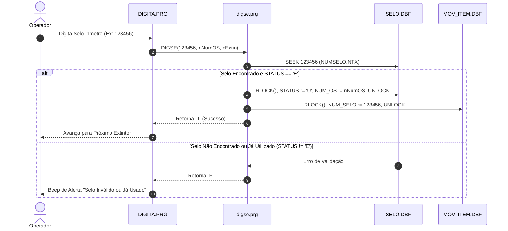

# Módulo Lançamento em Lote de Selos Inmetro (`digita_selos`), Design Técnico

> Gerado pelo Redator do Reversa em 2026-09-18  
> Nível de Documentação: **Detalhado**  
> Status: 🟢 **CONFIRMADO** (Baseado nos fontes `prg/DIGITA.PRG`, `prg/digse.prg`, `prg/acerto.PRG`)

---

## 1. Interface e Assinatura das Funções

| Símbolo | Assinatura / Parâmetros | Retorno | Descrição & Localização |
| :--- | :--- | :--- | :--- |
| `DIGITA()` | `()` | `NIL` | Loop principal da tela de digitação em lote. (`DIGITA.PRG:15`) |
| `DIGSE()` | `(nNumSelo: Numeric, nNumOS: Numeric, cExtin: Character)` | `Logical` | Valida, busca no NTX `NUMSELO.NTX` e consome o selo. (`digse.prg:40`) |
| `ACERTO_SELO()`| `(nNumSelo: Numeric, cMotivo: Character)` | `Logical` | Registra a perda do selo na tabela `FALTASEL.DBF`. (`acerto.PRG:25`) |

---

## 2. Fluxo Principal de Processamento de Selo

---

## 3. Decisões de Design Identificadas

| Decisão | Evidência no Código Legado | Confiança |
| :--- | :--- | :---: |
| **Executável / Menu Autônomo para Evitar Overhead TUI** | Estrutura isolada em `DIGITA.PRG` | 🟢 |
| **Atalho de Teclado Direto para Lançamento de Danificados** | Leitura de tecla `INKEY()` interceptando `K_F9` para chamar `ACERTO_SELO()` | 🟢 |

---

## 4. Riscos e Lacunas

- 🔴 **Concorrência em Faixas Sequenciais de Selos:** Se dois operadores lançarem selos da mesma faixa simultaneamente, pode ocorrer rejeição de leitura em `NUMSELO.NTX`.
