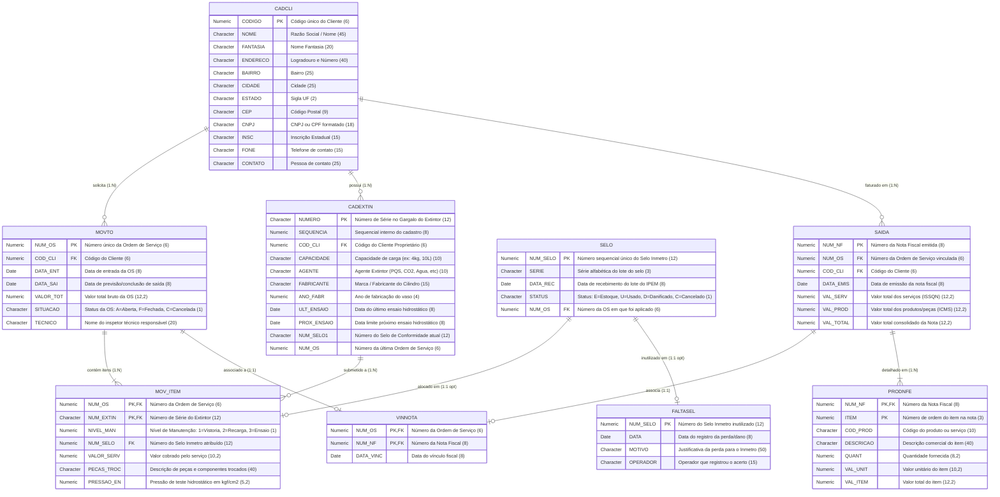

# Diagrama Entidade-Relacionamento Completo (ERD) — CICOM

> Gerado pelo Arquiteto do Reversa em 2026-09-18  
> Nível de Documentação: **Detalhado**  
> Status: 🟢 **CONFIRMADO** (Baseado nos arquivos DBF e índices NTX extraídos do código legados)

---

## 1. Diagrama ERD Completo em Mermaid

---

## 2. Dicionário Relacional Detalhado

### 2.1 Tabela `CADCLI.DBF` (Cadastro Mestre de Clientes)
- **Descrição:** Tabela principal contendo as entidades de clientes atendidos.
- **Arquivo de Índices:**
  - `CADCLICD.NTX` (Chave Primária Lógica: `STR(CODIGO,6)`)
  - `CADCLINM.NTX` (Busca Por Razão Social: `NOME`)

---

### 2.2 Tabela `CADEXTIN.DBF` (Cadastro Mestre de Extintores)
- **Descrição:** Tabela de ativos de segurança (cilindros). Um extintor pertence a um único cliente.
- **Arquivo de Índices:**
  - `CADEXTIN.NTX` (Chave Primária Lógica: `NUMERO`)
  - `CADEXTI1.NTX` (Busca por Cliente: `STR(COD_CLI,6)+NUMERO`)
  - `EXTSELO.NTX` (Busca por Selo Atual: `NUM_SELO1`)

---

### 2.3 Tabela `MOVTO.DBF` (Cabeçalho de Ordens de Serviço)
- **Descrição:** Registra a transação de entrada de um lote de extintores para manutenção.
- **Arquivo de Índices:**
  - `MOVTO.NTX` (Chave Primária Lógica: `STR(NUM_OS,6)`)
  - `MOVTO1.NTX` (Busca por Cliente e OS: `STR(COD_CLI,6)+STR(NUM_OS,6)`)

---

### 2.4 Tabela `MOV_ITEM.DBF` (Itens e Laudos de Serviço da OS)
- **Descrição:** Tabela de ligação N:M entre `MOVTO` e `CADEXTIN`, contendo os detalhes técnicos de cada extintor na OS.
- **Arquivo de Índices:**
  - `MOV_ITEM.NTX` (Chave Composta: `STR(NUM_OS,6)+NUM_EXTIN`)
  - `MOVITEM1.NTX` (Busca por Selo Aplicado: `STR(NUM_SELO,12)`)

---

### 2.5 Tabela `SELO.DBF` (Estoque e Alocação de Selos Inmetro)
- **Descrição:** Tabela de rastreabilidade de cada selo autoadesivo fornecido pelo IPEM/Inmetro.
- **Arquivo de Índices:**
  - `NUMSELO.NTX` (Chave Primária Lógica: `STR(NUM_SELO,12)`)

---

### 2.6 Tabela `FALTASEL.DBF` (Registro de Perdas e Inutilização de Selos)
- **Descrição:** Guarda a justificativa oficial de selos rasurados, rasgados, danificados ou extraviados.
- **Chave de Pesquisa Lógica:** `STR(NUM_SELO,12)`.

---

### 2.7 Tabela `SAIDA.DBF` (Notas Fiscais Emitidas)
- **Descrição:** Cabeçalho do faturamento gerado para encerramento de OS.
- **Arquivo de Índices:**
  - `SAIDA.NTX` (Chave Primária Lógica: `STR(NUM_NF,8)`).

---

## 3. Matriz de Integridade Referencial Implicita

Como o banco de dados ISAM/dBase III não possui suporte a `FOREIGN KEY` nativo, a integridade é mantida via **código Clipper**:

| Tabela Origem | Campo FK | Tabela Destino | Campo PK | Tipo de Validação | Localização no Código Legado |
| :--- | :--- | :--- | :--- | :--- | :--- |
| `MOVTO` | `COD_CLI` | `CADCLI` | `CODIGO` | Checagem por `SEEK` | `SIST1.PRG:45` |
| `CADEXTIN` | `COD_CLI` | `CADCLI` | `CODIGO` | Checagem por `SEEK` | `CADERNO1.PRG:110` |
| `MOV_ITEM` | `NUM_OS` | `MOVTO` | `NUM_OS` | Vínculo de Chave Parente | `CADERNO1.PRG:180` |
| `MOV_ITEM` | `NUM_EXTIN` | `CADEXTIN` | `NUMERO` | Checagem por `SEEK` | `CADERNO1.PRG:195` |
| `MOV_ITEM` | `NUM_SELO` | `SELO` | `NUM_SELO` | Trava de Status `STATUS == 'E'` | `digse.prg:60` |
| `SAIDA` | `NUM_OS` | `MOVTO` | `NUM_OS` | Checagem na baixa fiscal | `nota.prg:75` |
