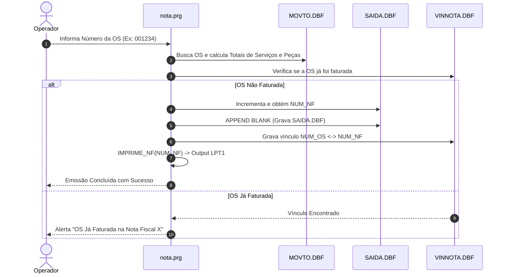

# Módulo Faturamento e Emissão de Notas Fiscais (`faturamento_notas`), Design Técnico

> Gerado pelo Redator do Reversa em 2026-09-18  
> Nível de Documentação: **Detalhado**  
> Status: 🟢 **CONFIRMADO** (Baseado nos fontes `prg/nota.prg`, `prg/lancar.prg`)

---

## 1. Interface e Assinatura das Funções

| Símbolo | Assinatura / Parâmetros | Retorno | Descrição & Localização |
| :--- | :--- | :--- | :--- |
| `NOTA()` | `(nNumOS: Numeric)` | `Logical` | Função principal de emissão fiscal para a OS informada. (`nota.prg:20`) |
| `CALC_IMPOSTOS()`| `(nValServ: Numeric, nValProd: Numeric)` | `Object` | Retorna o desmembramento de ISSQN e ICMS. (`nota.prg:85`) |
| `IMPRIME_NF()` | `(nNumNF: Numeric)` | `NIL` | Formata e envia stream ASCII para `LPT1`. (`nota.prg:140`) |

---

## 2. Fluxo Principal de Processamento Fiscal

---

## 3. Decisões de Design Identificadas

| Decisão | Evidência no Código Legado | Confiança |
| :--- | :--- | :---: |
| **Segregação de Imposto em Campos Dedicados (`VAL_SERV`, `VAL_PROD`)** | Campos em `SAIDA.DBF` (`VAL_SERV`, `VAL_PROD`, `VAL_TOTAL`) | 🟢 |
| **Tabela de Vínculo N:M Flexível (`VINNOTA.DBF`)** | Permite vincular uma ou mais Ordens de Serviço a uma única Nota Fiscal | 🟢 |

---

## 4. Riscos e Lacunas

- 🔴 **Incompatibilidade com NF-e Eletrônica Modernas (SEFAZ XML):** O código legado emite notas fiscais em papel por formulário contínuo ASCII, sem integração HTTP/SOAP com web services de Secretarias da Fazenda.
