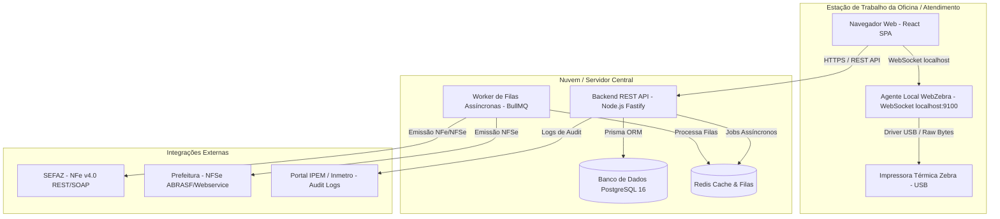

# Arquitetura Alvo do Sistema Moderno — CICOM Modern

> Gerado pelo Time de Migração Reversa (`/reversa-migrate`)  
> Projeto: **CICOM Modernization**  
> Data: 2026-09-28  

---

## 1. Visão Geral da Arquitetura Alvo

A modernização do sistema **CICOM** transiciona uma aplicação legada MS-DOS/Clipper (arquitetura monolítica ISAM baseada em arquivos `.DBF`/`.NTX` com impressão matricial LPT1) para uma **plataforma Web em arquitetura de microsserviços / monolito modular**.

### Principais Pilares da Modernização
1. **Frontend Web de Alta Produtividade:** Interface reativa moderna desenvolvida em React + Vite + Tailwind/CSS, mantendo suporte a atalhos de teclado de alta velocidade (para operações de oficina e digitação de selos).
2. **Backend API RESTful em TypeScript:** Serviços desacoplados rodando Node.js / Fastify com validação de schemas Zod.
3. **Persistência Relacional ACID:** Banco de dados PostgreSQL substituindo o ecossistema DBF sem suporte a transações.
4. **Agente de Impressão Local (WebZebra Agent):** Serviço leve em background (WebSocket local) executado nas estações para envio de payloads ZPL brutos diretamente via cabo USB para as impressoras Zebra.
5. **Módulo de Emissão Fiscal (NFe / NFSe):** Integração HTTP/SOAP assíncrona com SEFAZ (NFe v4.0) e Prefeituras.

---

## 2. Diagrama de Arquitetura de Containers (C4 Target)



---

## 3. Matriz de Tecnologia Sugerida (Target Tech Stack)

| Camada | Tecnologia Legada (Clipper) | Tecnologia Alvo (Modern) | Racional da Escolha |
| :--- | :--- | :--- | :--- |
| **Interface (UI)** | MS-DOS Text Mode (80x25) | React 19 + Vite + Tailwind CSS | Interface rica, responsiva e com suporte nativo a comandos por teclado. |
| **Linguagem Backend** | CA-Clipper 5.2 | Node.js (TypeScript) | Alta produtividade, tipagem estática ponta a ponta e vasto ecossistema. |
| **Banco de Dados** | Arquivos DBF / Índices NTX | PostgreSQL 16 + Prisma ORM | Integridade referencial, transações ACID e suporte a campos JSONB. |
| **Impressão Zebra** | Arquivos texto na porta `LPT1` | Payloads ZPL via WebSocket local | Impressão USB direta sem necessidade de spooler de rede complexo. |
| **Emissão Fiscal** | Spooler Matricial ASCII | Serviços de Integração NFe/NFSe | Automação completa de NFe v4.0 e NFSe com assinatura digital A1. |
| **Autenticação** | Tabela simples de usuários | JWT + RBAC (Role-Based Access Control) | Auditoria por operador e controle de permissões por perfil. |

---

## 4. Estrutura de Módulos da Nova Aplicação

```
cicom-modern/
├── backend/
│   ├── src/
│   │   ├── modules/
│   │   │   ├── cadastros/         # Clientes, Extintores, Componentes, Preços
│   │   │   ├── caderno_extintores/# Inspeções, Cargas e Ensaios Hidrostáticos
│   │   │   ├── digita_selos/      # Lançamento em lote e controle de estoque de Selos
│   │   │   ├── ordens_servico/    # Orçamentos, Recepção, Produção e Entrega
│   │   │   ├── faturamento/       # Emissão NFe/NFSe e Controle de Cobrança
│   │   │   └── etiquetas/         # Gerador de Payloads ZPL Zebra
│   │   ├── shared/                # Middlewares, DB Client, Helpers
│   │   └── server.ts
├── frontend/
│   ├── src/
│   │   ├── components/            # Design System & UI Reutilizável
│   │   ├── pages/                 # Telas da Aplicação
│   │   ├── services/              # API Client & Zebra WebSocket Agent
│   │   └── hooks/                 # Hooks de Teclado e Estado
└── zebra-agent/                   # Serviço leve em Go/Node para USB local
```

---

## 5. Regras de Negócio e Decisões de Migração Validadas

- **Validade do Ensaio Hidrostático:** Ajustada de `365 * 5` dias simples para cálculo exato de 5 anos no mesmo dia do calendário (ex: `18/09/2026` → `18/09/2031`), garantindo 100% de conformidade com as normas **ABNT NBR 12962/15808**.
- **Comunicação Zebra USB:** O frontend disparará os comandos ZPL via `WebSocket` local (`ws://localhost:9100`), conversando com o executável leve `WebZebra Agent` rodando na barra de tarefas do Windows das estações de trabalho.
- **Emissão Fiscal NFe/NFSe:** Emissão assíncrona com processamento em fila background, permitindo retentativa automática em oscilações da SEFAZ.
