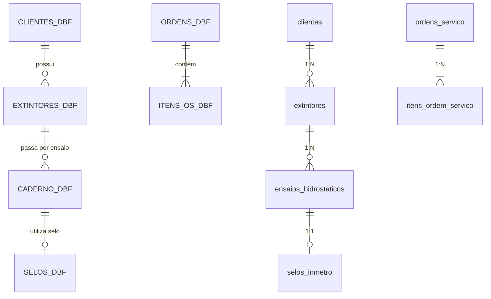

# Especificação de Migração de Dados (ETL) — CICOM Modern

> Gerado pelo Time de Migração Reversa (`/reversa-migrate`)  
> Projeto: **CICOM Modernization**  
> Data: 2026-09-28  

---

## 1. Mapeamento de De-Para (Legacy DBF → PostgreSQL Schema)

A migração de dados converterá os arquivos de banco de dados flat-file dBase III/IV (`.DBF`) legados para tabelas relacionais normativas no PostgreSQL.

---

## 2. Dicionário de Mapeamento de Tabelas e Campos

### 2.1. Tabela `CLIENTES.DBF` → `clientes`

| Campo DBF Legado | Tipo DBF | Campo PostgreSQL Alvo | Tipo PostgreSQL | Regra de Transformação / Sanitização |
| :--- | :--- | :--- | :--- | :--- |
| `COD_CLI` | Character(5) | `id` | UUID / Text | Mantido como referência legada e gerado UUID v4 primário. |
| `RAZAO` | Character(40) | `razao_social` | VARCHAR(120) | Trim de espaços em branco e conversão de codificação CP850 → UTF-8. |
| `FANTASIA` | Character(30) | `nome_fantasia` | VARCHAR(120) | Trim e UTF-8. |
| `CGC` | Character(14) | `cnpj_cpf` | VARCHAR(18) | Sanitização de caracteres não numéricos e formatação de máscara. |
| `ENDERECO` | Character(40) | `logradouro` | VARCHAR(150) | Trim e UTF-8. |
| `CIDADE` | Character(25) | `cidade` | VARCHAR(60) | Uppercase e UTF-8. |
| `UF` | Character(2) | `uf` | CHAR(2) | Validação da sigla com enum oficial do IBGE. |
| `FONE` | Character(15) | `telefone` | VARCHAR(20) | Normalização de DDD + Telefone. |

---

### 2.2. Tabela `EXTINTORES.DBF` → `extintores`

| Campo DBF Legado | Tipo DBF | Campo PostgreSQL Alvo | Tipo PostgreSQL | Regra de Transformação / Sanitização |
| :--- | :--- | :--- | :--- | :--- |
| `NUM_SERIE` | Character(12) | `numero_serie` | VARCHAR(30) | Chave de identificação única por extintor. Trim de espaços. |
| `COD_CLI` | Character(5) | `cliente_id` | Foreign Key (UUID) | Lookup na tabela `clientes` pelo código legado. |
| `FABRICANTE` | Character(15) | `fabricante` | VARCHAR(50) | Padronização de nomes de fabricantes (ex: Kidde, Resgatest, Bucka). |
| `CAPACIDADE` | Numeric(5,2) | `capacidade_carga` | DECIMAL(8,2) | Conversão para número decimal (kg ou litros). |
| `AGENTE` | Character(10) | `agente_extintor` | Enum | Mapeamento para Enum (`CO2`, `PQS_ABC`, `PQS_BC`, `AGUA_PRESS`, `FOAM`). |
| `ANO_FAB` | Numeric(4,0) | `ano_fabricacao` | INTEGER | Validação de intervalo válido (1950 a 2026). |
| `ULT_ENSAIO` | Date | `data_ultimo_ensaio` | DATE | Conversão de formato de data Clipper `YYYYMMDD` para ISO DATE. |

---

### 2.3. Tabela `SELOS.DBF` → `selos_inmetro`

| Campo DBF Legado | Tipo DBF | Campo PostgreSQL Alvo | Tipo PostgreSQL | Regra de Transformação / Sanitização |
| :--- | :--- | :--- | :--- | :--- |
| `NUM_SELO` | Numeric(9,0) | `numero_selo` | BIGINT (UNIQUE) | Validação de unicidade e intervalo autorizado pelo Inmetro. |
| `DAT_NIVEL` | Date | `data_aplicacao` | TIMESTAMP | Data do lançamento e selagem no equipamento. |
| `TECNICO` | Character(15) | `tecnico_responsavel` | VARCHAR(80) | Associação com o operador que realizou a selagem. |
| `STATUS` | Character(1) | `status` | Enum | Mapeamento para Enum (`APLICADO`, `PERDIDO`, `DEFEITUOSO`, `DISPONIVEL`). |

---

## 3. Pipeline de Execução do Script ETL

1. **Leitura e Extração:** O script node.js utilizará o parser `dbf-parser` para ler os arquivos fisicamente da pasta legada.
2. **Decodificação de Caracteres:** Conversão do encoding **CP850 / MS-DOS Latin 1** para **UTF-8**.
3. **Validação de Schemas:** Validação de integridade com Zod schemas antes da inserção.
4. **Inserção em Transação Relacional:** Inserção em lotes de 500 registros dentro de transações PostgreSQL (`BEGIN...COMMIT`) com rollback automático em caso de inconsistência de chave estrangeira.
5. **Relatório de Audit Log:** Geração do log `data-migration-report.json` com total de registros importados e divergências identificadas.
