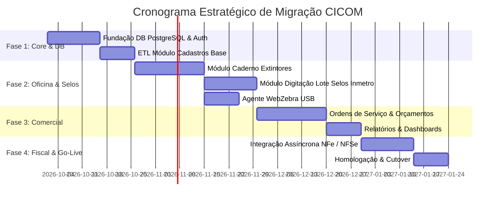

# Roadmap de Migração — CICOM Modern

> Gerado pelo Time de Migração Reversa (`/reversa-migrate`)  
> Projeto: **CICOM Modernization**  
> Data: 2026-09-28  

---

## 1. Estratégia Geral de Execução

A migração do sistema **CICOM** será executada em **4 Fases Sequenciais**, priorizando primeiro o núcleo de banco de dados e cadastros, seguido pela operação de oficina (o coração do negócio de ensaio e selos Inmetro), atendimento comercial e, por fim, a camada fiscal.

---

## 2. Detalhamento das Fases

### 🔷 Fase 1: Fundação do Banco de Dados & Cadastros Base
- **Objetivo:** Estabelecer a infraestrutura backend e migrar os cadastros fundamentais de dados.
- **Entregáveis:**
  - Esquema de Banco de Dados PostgreSQL configurado via Prisma ORM.
  - Script ETL de extração dos arquivos `CLIENTES.DBF`, `EXTINTORES.DBF` e `TABPRECO.DBF`.
  - API REST e telas de gerenciamento de Clientes, Extintores (por Nº de Série) e Tabela de Preços de Serviços/Peças.
  - Sistema de Autenticação JWT com papéis (Administrador, Atendente, Técnico de Oficina, Faturamento).

---

### 🔷 Fase 2: Operação de Oficina (Extintores & Selos Inmetro)
- **Objetivo:** Digitalizar a linha de produção, testes de bancada e lançamentos oficiais do Inmetro.
- **Entregáveis:**
  - **Caderno de Extintores (Caderno 1):** Registro de inspeções, recargas, trocas de peças e ensaios hidrostáticos com validação de validade ABNT (5 anos exatos).
  - **Digitação de Selos Inmetro:** Interface de alta produtividade otimizada para teclado com autocompletar e validação estrita da faixa numérica de selos.
  - **WebZebra Agent:** Serviço desktop local para transmissão de etiquetas ZPL via USB para impressoras Zebra.
  - Relatório de Rastreabilidade de Selos para Fiscalização IPEM/Inmetro.

---

### 🔷 Fase 3: Atendimento Comercial & Ordens de Serviço
- **Objetivo:** Gerenciar o fluxo completo de atendimento ao cliente, recepção e emissão de laudos.
- **Entregáveis:**
  - Abertura de Orçamentos e conversão em Ordens de Serviço (OS).
  - Controle de Status da OS: `Recepção` → `Triagem/Oficina` → `Aprovado` → `Concluído` → `Entregue`.
  - Emissão e impressão de Laudo de Vistoria / Certificado de Garantia Inmetro.
  - Dashboard operacional com indicadores de produtividade por técnico e ordens pendentes.

---

### 🔷 Fase 4: Módulo Fiscal, Testes Integrados & Cutover
- **Objetivo:** Automação fiscal e substituição definitiva do sistema legado Clipper.
- **Entregáveis:**
  - Emissão de Nota Fiscal Eletrônica de Venda (**NFe v4.0**).
  - Emissão de Nota Fiscal de Serviço (**NFSe Municipal**).
  - Retentativas assíncronas com tratamento de contingência.
  - Teste de carga, treinamento com os operadores da oficina e virada de chave (Cutover).

---

## 3. Critérios de Aceite para Cutover (Go-Live)

1. **Rastreabilidade de Selos:** 100% dos selos lançados no sistema moderno devem bater exatamente com a sequência física e histórica do legado.
2. **Conformidade ABNT:** A validação de datas de vencimento do ensaio hidrostático deve manter a regra de calendário ajustada de 5 anos exatos.
3. **Desempenho de Impressão:** O envio de comandos de impressão de etiquetas Zebra USB via agente local deve responder em menos de 500ms por etiqueta.
4. **Integridade de Faturamento:** Nenhuma OS concluída pode ser entregue sem a devida associação de NFe/NFSe transmitida com sucesso.
