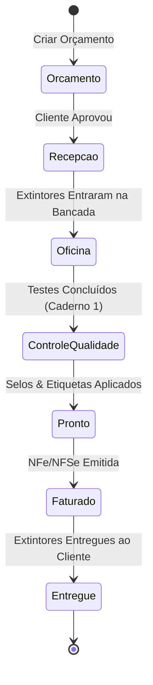

# Especificação de Tela: Central de Ordens de Serviço — CICOM Modern

> Gerado pelo Screen Translator Reversa (`/reversa-migrate`)  
> Componente / Rota: `/comercial/ordens-servico`  
> Data: 2026-09-28  

---

## 1. Visão Geral da Tela

Esta tela é o núcleo do módulo comercial e de atendimento (`sist_main`), permitindo cadastrar orçamentos, emitir ordens de serviço (OS) de manutenção e inspeção de extintores, acompanhar o status da produção e emitir comprovantes de recebimento e entrega.

---

## 2. Layout da Interface (Wireframe / Mockup Structural)

```
+-----------------------------------------------------------------------------------+
|  Central de Ordens de Serviço (OS) & Orçamentos                                   |
+-----------------------------------------------------------------------------------+
|  [ + Nova Ordem de Serviço ]   Filtros: Status [ Todos v ] Cliente [ Digite... ]  |
+-----------------------------------------------------------------------------------+
|  Nº OS | Cliente               | Data Entrada | Extintores | Valor Total | Status |
|  1042  | Usina Santa Rita S/A   | 28/09/2026   | 15 Un.     | R$ 2.450,00 | Oficina|
|  1041  | Condomínio Solar      | 27/09/2026   | 4 Un.      | R$ 680,00   | Pronto |
|  1040  | Transportes Silva     | 25/09/2026   | 20 Un.     | R$ 3.100,00 | Entregue
+-----------------------------------------------------------------------------------+
|  DETALHES DA OS SELECIONADA (#1042)                                               |
|  Cliente: Usina Santa Rita S/A (CNPJ: 12.345.678/0001-90)                         |
|  Itens / Extintores da OS:                                                        |
|  - 05 x Extintor PQS ABC 4kg (Ensaio Hidrostático + Carga) - R$ 120,00/un         |
|  - 10 x Extintor CO2 6kg (Recarga + Selo Inmetro)          - R$ 185,00/un         |
|                                                                                   |
|  [ F4 - Imprimir Comprovante Recepção ]  [ F7 - Gerar Faturamento NFe/NFSe ]      |
+-----------------------------------------------------------------------------------+
```

---

## 3. Fluxo de Estado da Ordem de Serviço


