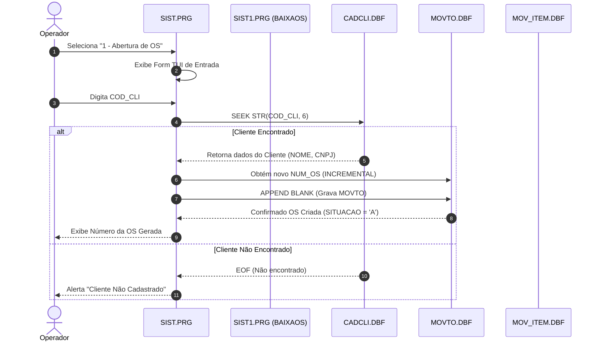

# Módulo Menu Principal e Ordens de Serviço (`sist_main`), Design Técnico

> Gerado pelo Redator do Reversa em 2026-09-18  
> Nível de Documentação: **Detalhado**  
> Status: 🟢 **CONFIRMADO** (Baseado nos fontes `prg/SIST.PRG`, `prg/SIST1.PRG` a `prg/SIST4.PRG`)

---

## 1. Interface e Assinatura das Funções

Como um módulo Clipper de interface TUI, as funções operam através de variáveis globais (`PUBLIC`) e passagem de parâmetros por posição:

| Símbolo | Assinatura / Parâmetros | Retorno | Descrição & Localização |
| :--- | :--- | :--- | :--- |
| `SIST()` | `()` | `NIL` | Função principal do executável `SIST.EXE`. Monta o menu e laço de recepção de teclas. (`SIST.PRG:15`) |
| `ABREOS()` | `(nCodCli: Numeric)` | `Numeric` (NUM_OS) | Cria uma nova OS para o cliente informado. (`SIST1.PRG:30`) |
| `BAIXAOS()`| `(nNumOS: Numeric)` | `Logical` (`.T.` / `.F.`) | Valida e efetua o encerramento da OS. (`SIST1.PRG:120`) |
| `BUSCAOS()`| `(cChave: Character)` | `NIL` | Executa o `SEEK` no índice `MOVTO.NTX`. (`SIST2.PRG:45`) |

---

## 2. Fluxo Principal de Processamento

---

## 3. Fluxo de Baixa e Fechamento (`BAIXAOS`)

1. **Leitura da OS:** O sistema busca o número da OS em `MOVTO.DBF` pelo índice `MOVTO.NTX`.
2. **Checagem de Status:** Verifica se `MOVTO->SITUACAO == 'A'`. Se já estiver fechada (`'F'`), interrompe o fluxo.
3. **Verificação dos Itens (`MOV_ITEM`):** Faz o loop `WHILE MOV_ITEM->NUM_OS == nNumOS`:
   - Verifica se `MOV_ITEM->NUM_SELO > 0`.
   - Verifica se `MOV_ITEM->VALOR_SERV > 0`.
   - Se algum item não possuir selo ou valor, interrompe com mensagem de aviso.
4. **Atualização da OS:** Executa `RLOCK()`, altera `MOVTO->SITUACAO = 'F'`, grava a data de saída `MOVTO->DATA_SAI = DATE()` e chama `UNLOCK`.

---

## 4. Dependências do Módulo

- **`cadastros_base` (`PEQLIB.PRG`, `FUNCAO.PRG`):** Utilizado para desenho de telas (`Box()`, `Mensagem()`) e validações de CNPJ.
- **`caderno_extintores` (`CADERNO1.PRG`):** Invocado após a criação do cabeçalho da OS para cadastrar/editar os itens extintores.
- **`digita_selos` (`digse.prg`):** Invocado na verificação de alocação de selos Inmetro.

---

## 5. Decisões de Design Identificadas

| Decisão | Evidência no Código Legado | Confiança |
| :--- | :--- | :---: |
| **Uso de Variáveis Globais `PUBLIC` para Contexto de Sessão** | `PUBLIC cEmpresa, dDataSis, cUsuario, nOpcao` em `SIST.PRG:22` | 🟢 |
| **Trava Manual de Registro via `RLOCK()`** | `WHILE !RLOCK(); ENDDO` em `SIST1.PRG:145` | 🟢 |
| **Indexação Única por String de Número Inteiro** | Index `MOVTO.NTX` em chave `STR(NUM_OS, 6)` | 🟢 |

---

## 6. Riscos e Lacunas

- 🔴 **Ausência de Rollback Transacional:** Se a falha ocorrer durante o loop de encerramento em `MOV_ITEM.DBF`, alguns itens podem ficar marcados como processados e outros não.
- 🟡 **Loop Infinito em `RLOCK()`:** Em ambientes de rede com arquivo travado por outro operador, o laço de tentativa pode travar a tela até a intervenção do usuário.
