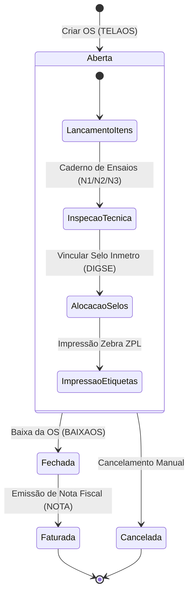
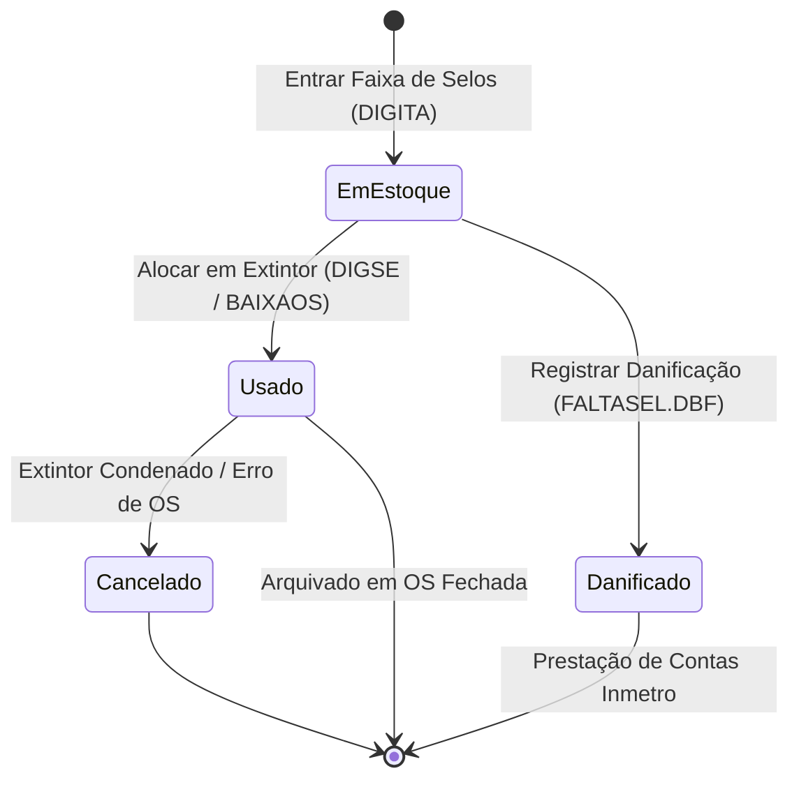
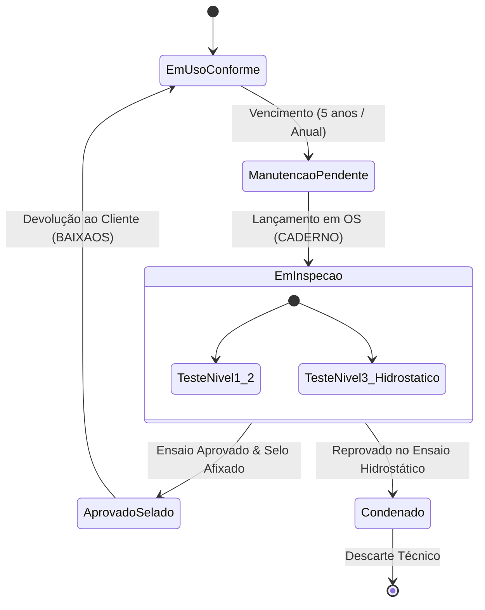

# Máquinas de Estado do Sistema Legado — CICOM

> Gerado pelo Detetive do Reversa em 2026-09-18
> Nível de Documentação: **Detalhado**

---

## 1. Visão Geral

As máquinas de estado do sistema **CICOM** governam o ciclo de vida das entidades centrais do negócio: **Ordem de Serviço**, **Selo de Conformidade Inmetro** e **Cilindro / Extintor**.

---

## 2. Máquina de Estado: Ordem de Serviço (`MOVTO.SITUACAO`)

A Ordem de Serviço (OS) rastreia o ciclo de atendimento ao cliente desde o recebimento do lote de extintores até o faturamento e entrega.

### 2.1 Tabela de Transição de Estados

| Estado Origem | Evento / Gatilho | Estado Destino | Condição de Transição | Confiança |
| :--- | :--- | :--- | :--- | :---: |
| *(Novo)* | Recepção do Lote de Extintores (`TELAOS`) | `A` (Aberta) | Dados do cliente e data de entrada informados | 🟢 |
| `A` (Aberta) | Conclusão da Inspeção e Selagem (`BAIXAOS`) | `F` (Fechada) | Todos os itens possuem selo alocado e laudo preenchido | 🟢 |
| `A` (Aberta) | Cancelamento Solicitado pelo Cliente/Gerente | `C` (Cancelada) | OS sem emissão de Nota Fiscal | 🟢 |
| `F` (Fechada) | Reabertura por Erro de Lançamento | `A` (Aberta) | Autorização especial e OS sem faturamento final | 🟡 |

### 2.2 Diagrama de Estados (Mermaid)

---

## 3. Máquina de Estado: Selo Inmetro (`SELO.STATUS`)

O Selo Inmetro é um insumo crítico sujeito a auditoria rigorosa de órgãos reguladores. Cada unidade possui um ciclo de vida individualizado.

### 3.1 Tabela de Transição de Estados

| Estado Origem | Evento / Gatilho | Estado Destino | Condição de Transição | Confiança |
| :--- | :--- | :--- | :--- | :---: |
| *(Novo)* | Recebimento do Lote pelo Certificador | `E` (Em Estoque) | Cadastro da faixa sequencial via `DIGITA.PRG` | 🟢 |
| `E` (Em Estoque) | Aplicação no Cilindro (`DIGSE` / `BAIXAOS`) | `U` (Usado) | Vínculo a extintor em OS ativa | 🟢 |
| `E` (Em Estoque) | Danificação / Rasura durante Manuseio | `D` (Danificado / Falta) | Registro do motivo em `FALTASEL.DBF` | 🟢 |
| `U` (Usado) | Cancelamento da OS / Extintor Condenado | `C` (Cancelado) | Selo descartado e substituído | 🟢 |

### 3.2 Diagrama de Estados (Mermaid)

---

## 4. Máquina de Estado: Cilindro de Extintor (`CADEXTIN`)

O vaso de pressão passa por avaliações periódicas para manter a homologação de uso.

### 4.1 Tabela de Transição de Estados

| Estado Origem | Evento / Gatilho | Estado Destino | Condição de Transição | Confiança |
| :--- | :--- | :--- | :--- | :---: |
| `Em Uso (Conforme)` | Vencimento de Ensaio / Agente | `Manutenção Pendente` | `PROX_ENSAIO <= DATA_ATUAL` ou inspeção anual | 🟢 |
| `Manutenção Pendente`| Recepção na Oficina | `Em Inspeção` | Extintor lançado na OS (`CADERNO1.PRG`) | 🟢 |
| `Em Inspeção` | Teste de Pressão Aprovado (Nível 3) | `Aprovado / Selado` | Presença de laudo de ensaio (`PRESSAO_EN`) e selo novo | 🟢 |
| `Em Inspeção` | Reprovação por Deformação / Corrosão | `Condenado / Sucateado` | Laudo técnico de reprovação no ensaio hidrostático | 🟡 |
| `Aprovado / Selado` | Devolução ao Cliente | `Em Uso (Conforme)` | Encerramento e baixa da OS | 🟢 |

### 4.2 Diagrama de Estados (Mermaid)

