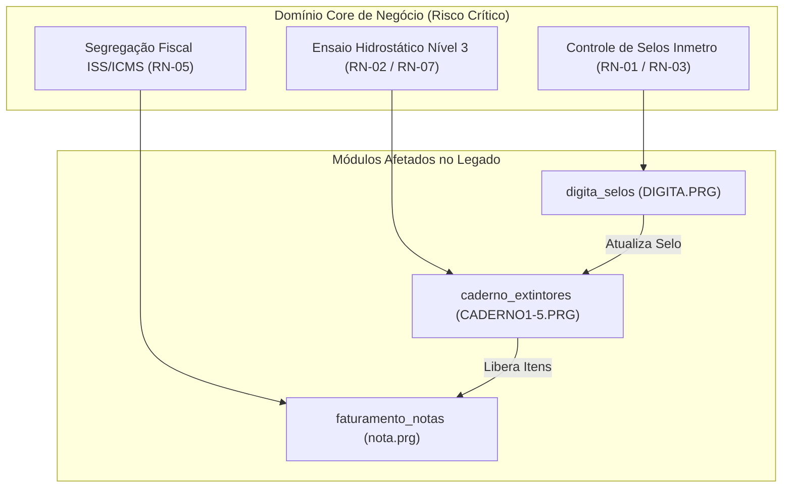

# Matriz de Impacto de Especificações (Spec Impact Matrix) — CICOM

> Gerado pelo Arquiteto do Reversa em 2026-09-18  
> Nível de Documentação: **Detalhado**  
> Status: 🟢 **CONFIRMADO**

---

## 1. Visão Geral da Matriz de Impacto

Esta matriz mapeia as dependências cruzadas entre os **Módulos do Sistema Legado**, as **Tabelas de Dados (DBF)**, as **Regras de Negócio (RN)** e as **Decisões Arquiteturais (ADR)**.

Utilize esta matriz durante o processo de **evolução (ciclo forward)** ou **migração de arquitetura** para identificar antecipadamente o efeito dominó (cascade impact) de qualquer alteração em componentes.

---

## 2. Matriz de Módulos vs Artefatos de Dados e Regras

| Módulo Legado | Arquivos PRG Impactados | Tabelas DBF Manipuladas | Regras de Negócio Afetadas | ADRs Associadas | Grau de Risco |
| :--- | :--- | :--- | :--- | :--- | :---: |
| **`sist_main`** | `SIST.PRG`, `SIST1.PRG`, `SIST2.PRG` | `MOVTO.DBF`, `CADCLI.DBF` | **RN-04** (Status OS) | [ADR 0001](file:///c:/Inmetro/_reversa_sdd/adrs/0001-arquitetura-monolitica-clipper-overlays.md), [ADR 0002](file:///c:/Inmetro/_reversa_sdd/adrs/0002-banco-de-dados-isam-dbf-ntx.md) | 🔴 Alto |
| **`caderno_extintores`** | `CADERNO1.PRG` a `CADERNO5.PRG`, `caderno.prg` | `CADEXTIN.DBF`, `MOV_ITEM.DBF` | **RN-02** (5 Anos Ensaio), **RN-06** (Chave Cilindro), **RN-07** (Pressão) | [ADR 0001](file:///c:/Inmetro/_reversa_sdd/adrs/0001-arquitetura-monolitica-clipper-overlays.md), [ADR 0004](file:///c:/Inmetro/_reversa_sdd/adrs/0004-impressao-direta-zpl-spooler-matricial.md) | 🔴 Alto |
| **`digita_selos`** | `DIGITA.PRG`, `digse.prg`, `acerto.PRG` | `SELO.DBF`, `MOV_ITEM.DBF`, `FALTASEL.DBF` | **RN-01** (Selo Obrigatório), **RN-03** (Controle Perdas) | [ADR 0003](file:///c:/Inmetro/_reversa_sdd/adrs/0003-modulo-independente-alta-produtividade-digita.md) | 🟡 Médio |
| **`faturamento_notas`** | `nota.prg`, `lancar.prg`, `Fol.prg` | `SAIDA.DBF`, `PRODNFE.DBF`, `VINNOTA.DBF` | **RN-05** (ISSQN vs ICMS) | [ADR 0002](file:///c:/Inmetro/_reversa_sdd/adrs/0002-banco-de-dados-isam-dbf-ntx.md) | 🔴 Alto |
| **`etiquetas_zebra`** | `EtiZebra/` (`ETIQUETA.PRG`) | Nenhuma (lê de `CADEXTIN`/`SELO`) | **RN-01** (Selo em Etiqueta) | [ADR 0004](file:///c:/Inmetro/_reversa_sdd/adrs/0004-impressao-direta-zpl-spooler-matricial.md) | 🟢 Baixo |
| **`cadastros_base`** | `PEQLIB.PRG`, `FUNCAO.PRG`, `TBR12.PRG` | `CADCLI.DBF` | **RN-06** (Validação CNPJ/CPF) | [ADR 0002](file:///c:/Inmetro/_reversa_sdd/adrs/0002-banco-de-dados-isam-dbf-ntx.md) | 🟡 Médio |

---

## 3. Matriz de Dependência Cruzada entre Módulos (Impact Matrix)

| Módulo Modificado / Afetado | `sist_main` | `caderno_extintores` | `digita_selos` | `faturamento_notas` | `etiquetas_zebra` | `cadastros_base` |
| :--- | :---: | :---: | :---: | :---: | :---: | :---: |
| **`sist_main`** | — | 🔀 Direto | 🔀 Direto | 🔀 Direto | 🔗 Indireto | 🔀 Direto |
| **`caderno_extintores`** | 🔀 Direto | — | 🔀 Direto | 🔀 Direto | 🔀 Direto | 🔀 Direto |
| **`digita_selos`** | 🔀 Direto | 🔀 Direto | — | 🔗 Indireto | 🔗 Indireto | ⚪ Nenhum |
| **`faturamento_notas`** | 🔀 Direto | 🔀 Direto | 🔗 Indireto | — | ⚪ Nenhum | 🔀 Direto |
| **`etiquetas_zebra`** | ⚪ Nenhum | 🔀 Direto | 🔗 Indireto | ⚪ Nenhum | — | ⚪ Nenhum |
| **`cadastros_base`** | 🔀 Direto | 🔀 Direto | 🔀 Direto | 🔀 Direto | ⚪ Nenhum | — |

**Legenda:**
- 🔀 **Direto:** Modificação no módulo origem quebra diretamente a execução do módulo destino.
- 🔗 **Indireto:** Dependência de dados (ex: leitura de arquivo DBF comum ou relatório consolidado).
- ⚪ **Nenhum:** Sem acoplamento operacional ou de dados.

---

## 4. Análise de Risco de Alteração por Domínio

### 4.1 Risco 1: Alteração no Fluxo de Atribuição de Selo Inmetro (`digita_selos`)
- **Impacto em Cascata:** Qualquer alteração no schema de `SELO.DBF` ou no status do selo impacta diretamente a rotina `BAIXAOS()` em `SIST1.PRG` e a geração do laudo técnico em `CADERNO1.PRG`.
- **Ação Mitigadora:** Testar exaustivamente a consistência entre `SELO.STATUS` e `MOV_ITEM.NUM_SELO`.

### 4.2 Risco 2: Alteração na Data do Ensaio Hidrostático (`caderno_extintores`)
- **Impacto em Cascata:** O cálculo automático de 5 anos (`PROX_ENSAIO = ULT_ENSAIO + 5 anos`) afeta a emissão do laudo perante o Inmetro e pode impedir a baixa de extintores em vistorias futuras.
- **Ação Mitigadora:** Manter a regra de cálculo centralizada na camada de serviço de domínio.

### 4.3 Risco 3: Alteração nas Regras Fiscais (`faturamento_notas`)
- **Impacto em Cascata:** Alterações no cálculo das alíquotas afetam a geração das notas em `SAIDA.DBF` e a conciliação do livro caixa da empresa.
- **Ação Mitigadora:** Isolar as regras de desmembramento de serviços (ISSQN) e reposição de componentes (ICMS).
